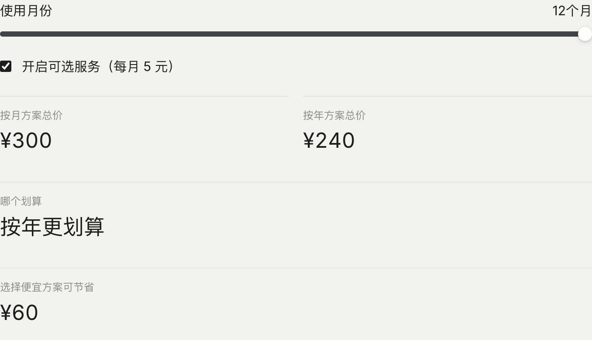
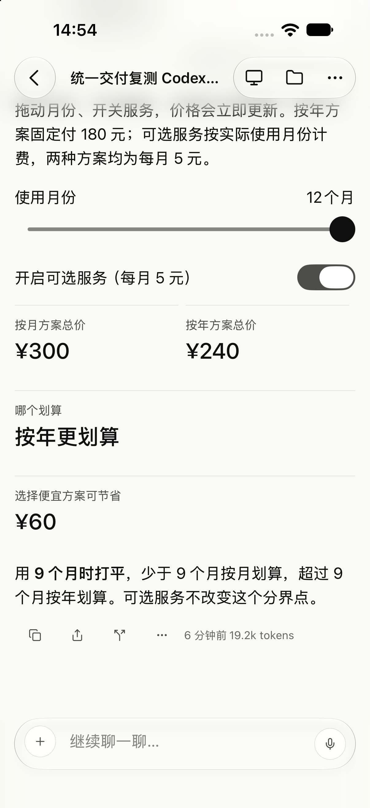
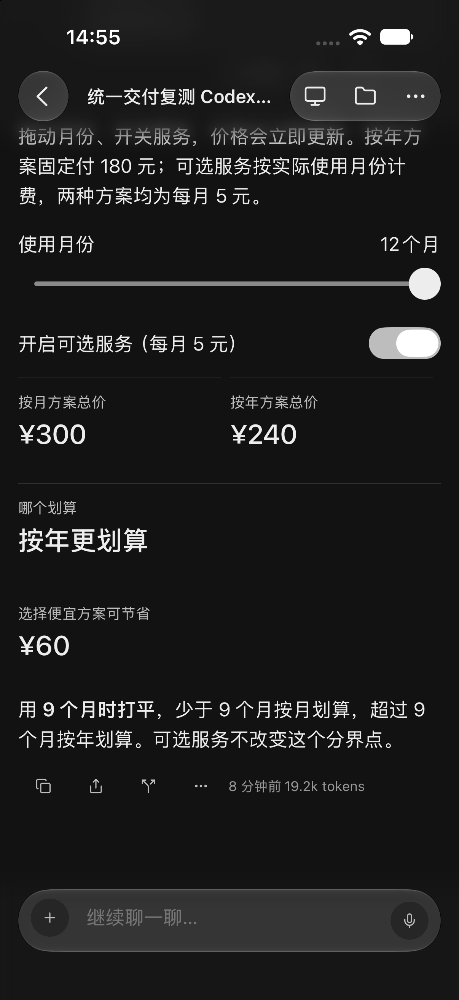
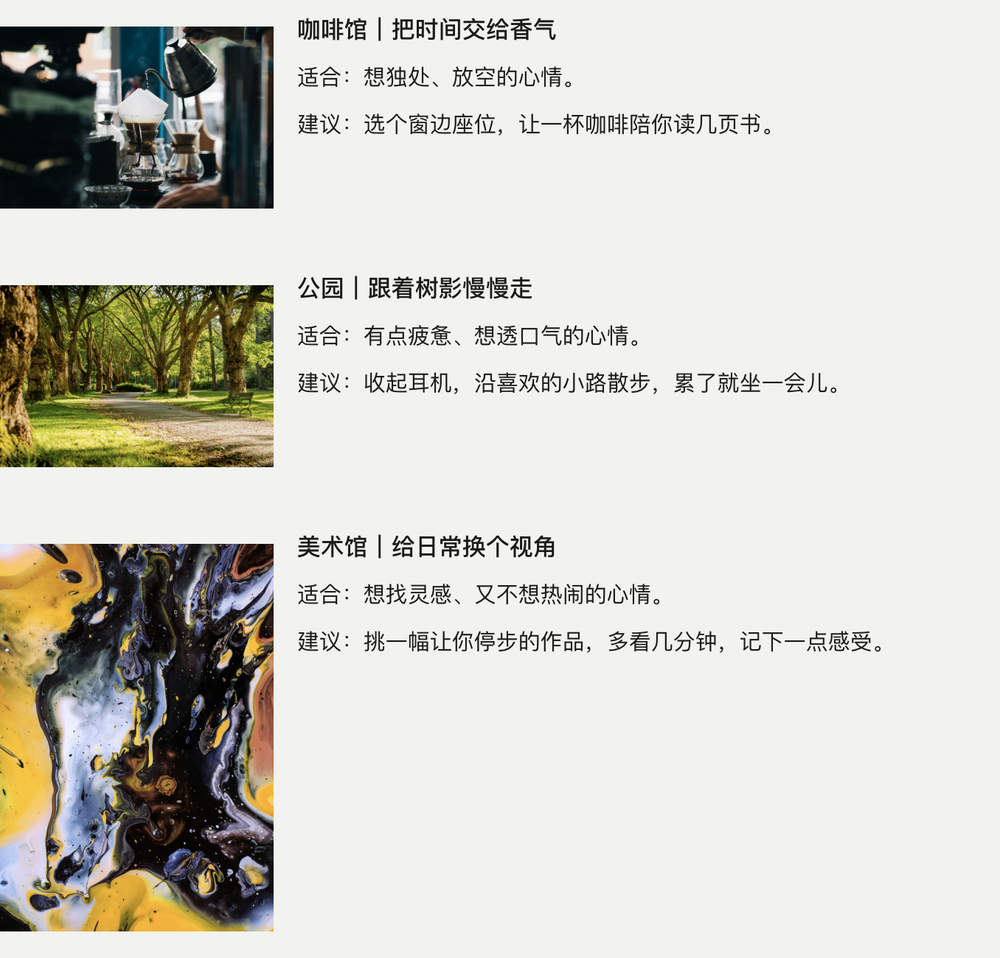
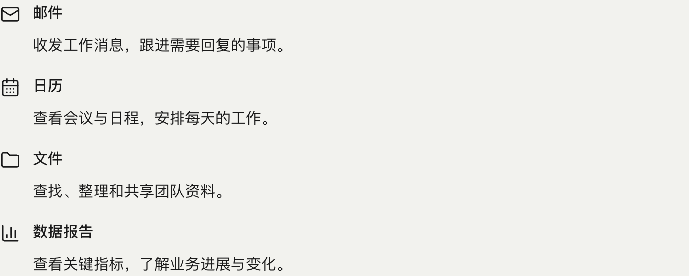
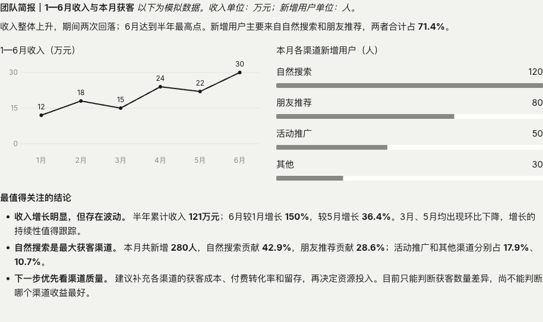
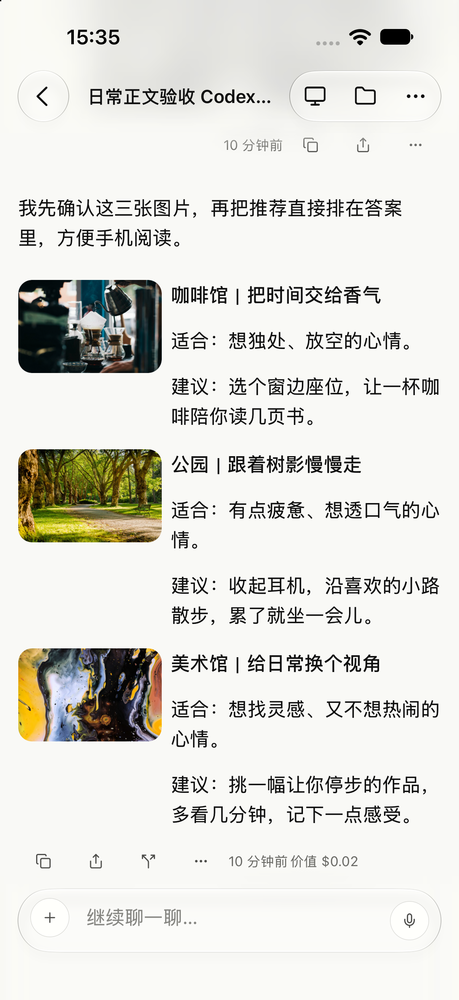
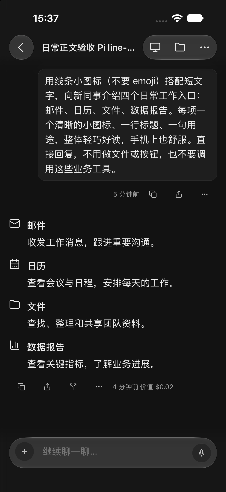
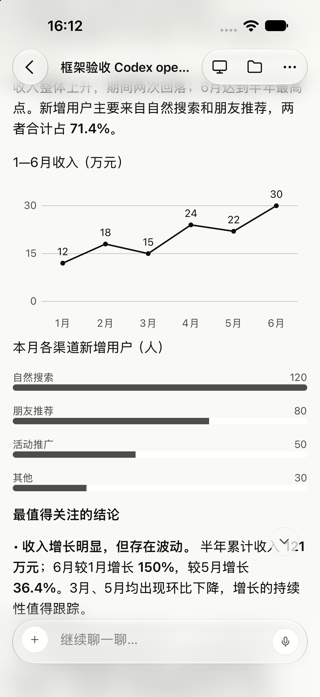

# 流式正文与可组合组件

2026-10-18 用户确认：Cindy 提供流式编辑器和组件库，模型自由编排正文。普通任务与伙伴、外露进展与最终答案共用一套展示能力。不是完整 HTML 文件预览，也不依赖特定模型或 OpenAI 内部协议。

## 输入与展示

文本型 Harness 复用现有累积文本事件，以 `cindy-ui` 围栏承载逐行操作。每一完整操作行即可提交，无需等围栏或回答完成。普通 Markdown 仍用现有正文组件。用户消息、引用内嵌示例与文件预览不启用组件解释。

共享解析器保存稳定节点：create、append、patch、move、remove。节点按 id 更新；输入、勾选和选择值与模型默认值分开。Markdown、图片、视频、公式和 Mermaid 沿用现有文件来源与预览边界。布局仅接受组件属性，不执行模型 HTML、CSS 或 JavaScript。数值表达式只支持有界的算术/选择树；按钮仅修改本地界面状态。

Desktop 使用原生 React 组件；Mobile 使用原生 View/Text 与既有媒体组件，不新增原生依赖或 runtime fingerprint。浅深主题取各端语义 token，窄屏按可用宽度换行。

## 恢复与容量

原始操作流作为原消息正文持久保存，重新打开时从原文还原文档。完整累计文本快照天然包含断线前的操作；序号重复不重复执行，缺口保留已提交内容并报告未能显示部分。历史传输超过原有预算时先合并为完整树快照，仍超限则使用可读正文降级并保留原有远程截断标记，不传半截操作 JSON。

用户值在查看端保存，按账号、消息、片段隔离；手机另包含来源设备和任务身份，不进入模型上下文。缓存最多 256 个片段、总序列化 524288 个字符；未修改控件继续使用模型默认值。异步读取不会覆盖加载期间新输入。当前查看端之间不自动同步控件状态。旧客户端没有组件渲染器，可能显示原始围栏；对不支持组件的渠道可使用普通 Markdown。

## 公共交付入口

统一路径只有：**公共交付说明与已有用户偏好 → 当前模型生成 → Cindy 流式展示**。

`ANSWER_DELIVERY_PROMPT` 在 `packages/maker-shared/src/richAnswerGuide.ts` 定义一次；Desktop Host 通过 runtime config 的 `answerDeliveryPrompt` 提供给三个适配器。Codex 使用现有 developer instructions，Claude Code 使用现有 system append（本地与远端），Pi 使用现有 `--append-system-prompt`。普通任务和伙伴都使用这一段，不因伙伴跳过普通 Cindy 身份说明而丢失交付能力。隔离 Reviewer 不注入这一段。

这是一项明确的宿主提示词改动：直接告诉当前模型可用组件、流式操作格式与交互边界。无需先调用发现工具，也不增加第二次答案优化调用。能力查询仍返回同一份协议，避免两份规则。用户偏好沿用已有 userPrompt、伙伴用户档案与当轮请求，不新增偏好存储，不修改或覆盖 CLI 二进制、原生提示词和模型缓存。

模型自由组合布局；简单回答、代码和显式要求的格式保持简洁。组件仅适用于 Cindy 正文，外部渠道沿用其格式。控件只改变本地查看状态，不执行工具、不提交用户输入。原有执行、停止、上下文压缩及工作过程折叠流程不变。计算可引用输入与其它计算节点；缺失、循环或非法计算显示局部不可用，不伪造零值。流式尚未到达的引用先等待。

公共交付说明以表达目标、阅读层次和视觉组织为框架，明确要求优雅、美观、易读；模型根据内容自行决定组件、布局和强调方式，不使用场景白名单或固定组件组合。图文、图标、图表与控件是可组合能力，不要求用户点名后才使用。协议例子只说明语法，验收场景不构成输出模板。简短内容仍可简短表达，用户指定格式优先。

当前图表外观仍由组件固定，仅支持单系列折线/条形与数据标签。用户已否决其视觉效果；下述数据正确性和展示检查不代表视觉设计通过。更新后的通用交付说明已完成三 Harness 真实生成复测（见末节），图表设计空间与默认样式仍待优化。当前版本按用户要求进入 PR 评审，送审不代表视觉优化或全部验收已经完成。

## 验收状态

本地实现与定向测试已完成。通过隔离 Cindy 的实际 maker 入口运行 18 次：5 个自然请求（费用比较、图文、简短算术、代码、勾选清单）× Codex / Claude Code / Pi，加上三种 Harness 各一个测试伙伴。12 份组件正文均无解析错误和不可用计算，6 份简单/代码回答使用普通正文。三个费用比较在 12 个月并开启服务时均显示 300 / 240、省 60；清单勾选两项后均为 2 / 4。伙伴沿用用户档案的“清单在前、完成数量在后”偏好。单次样本不代表稳定成功率；Claude Code 的代码回答多了一句说明，费用回答有空代码围栏，已在报告保留。

iPhone 原生测试版回放真实结果，已检查任务、伙伴、流式到完成态、控件联动、窄列图文、浅深色与重启恢复。原生无障碍滑杆增减已验证，手指拖动尚未单独验收。手机使用已有 Visual Mock 接口，不代替登录后的跨设备 Device Link 全链路；该链路以及本次视频播放、SSH 媒体仍未重新实测。

共享解析/消息测试 85 项；Desktop 组件、伙伴投影、历史摘要和远程传输 145 项；Mobile 伙伴投影 23 项；三 Harness 真实指令组装定向测试 4 项。两端类型检查、共享包构建检查通过，未跑无关全量。实测修复了移动端流式到历史行的身份切换、桌面立即重载丢控件值，以及计算节点引用静默归零。

当前组件使用宿主主题，不支持任意 HTML/CSS 或文字颜色；按钮只改本地状态。原型中的外部动作、自定义隔离可视化尚未接入，不宣称全部原型设想已交付。

旧完整 HTML 预览路径已移除，其旧验收不覆盖本实现。送审不代表跨设备补充验收已完成；合并/发布前仍须补齐上面列明的相关场景。

## 日常正文补充验收（2026-10-18）

按用户纠正，新增 15 次真实 maker 调用：照片图文、图标说明、数据简报各 3 种 Harness，加上原生线条图标与图表修正后的 6 次复测。请求只描述用户要看的内容，没有指定组件协议或手写模型答案。14 份组件正文解析无错误；Pi 的首次图标说明采用普通 Markdown + emoji，属于有效简洁输出。明确要求线条图标后，三种 Harness 均选中 mail/calendar/folder/chart 四个原生图标。三份图文均加载 coffee/park/art 三张真实照片；六组图表（折线 + 条形）全部 60 个数值与输入一致。

实测发现并修复：折线图原先只有线，必须对照下方列表才能读数；现有共享坐标计算，桌面与手机都直接展示刻度、点值和类别。补充原生线条图标，未知名称保留文字并使用通用图标，不加载任意资源。两项生产渲染入口回归通过，包含流式数据修改后的标签和可读结果（组件 5/5，2.16s）；共享 85 项、两端类型检查、测试卫生检查通过。这里只扩展已授权公共能力说明中的图标与图表属性，没有新增模型后处理。

桌面浅/深色各查看 15 份实际结果，没有解析提示或横向溢出。iPhone 浅/深色回放图文、原生图标与修正图表的三 Harness 结果。六次复测均记录到模型尚未结束时已显示的正文组件。手机照片通过本机测试 HTTP 映射读取，明确不当作跨设备媒体取件已通过。调试版沿用的导航弃用与 Reanimated 警告已留在运行记录，截图时收起调试提示，没有修改生产日志规则。

## 界面证据

真实模型费用比较，12 个月并开启服务；宿主原生组件显示 300 / 240、省 60。图片只含本任务合成测试内容。

| iOS 浅色（原生回放） | iOS 深色（原生回放） |
| --- | --- |
|  |  |

### 常见输出（真实模型生成）

| iOS 图文 | iOS 原生图标（深色） | iOS 数据图 |
| --- | --- | --- |
|  |  |  |

## 通用设计框架复测（2026-10-18）

使用更新后的公共说明，经隔离 Desktop 的 maker 入口新建 12 个真实任务：照片行程、团队数据简报、新同事说明、简单算术 × Codex / Claude Code / Pi。请求只提供内容与阅读目标，没有指定组件协议、图表类型或布局。模型分别为 gpt-6.1-sol、claude-sonnet-5-5、chatgpt/gpt-6.1-sol，使用原订阅，每个样本一次生成，无额外答案优化调用。

9 份主要答案均自行采用组件，并在模型结束前观察到组件显示；生产解析器没有错误或不可用计算。三份数据简报的 30 个输入数值全部一致，三份图文各保留三张真实照片，三份新同事说明各自行选择四个原生图标。三个算术答案均正确回答 391 且不使用组件。结构确有差异：Codex 并排双图、Claude Code 指标概览加分段图表、Pi 指标概览加并排双图。实际四个 Pi RPC 进程的 `--append-system-prompt` 均包含新版说明，桥接未移除该段；不据此声称已启动的旧进程也自动获得新版说明。

实测发现手机两列图表挤压月份和数值，修复为正文可用宽度不超过 600 时将普通 row/grid 改为单列；旁置图片保持其专用布局，宽屏仍保留模型选择。桌面生产组件在 393 像素容器验证两图上下排列、标签和数值保留、无横向溢出。手机原生回放九份实际答案，修复后重看浅深色和答案不同段落；照片仅在测试 fixture 中映射到本机 HTTP，不代替 Device Link 全链路。测试滚动调用列表接口及拖动处理，不宣称完成手势验收。桌面组件 5 项（1.14s）、Mobile 类型检查通过；未新增仅检查 CSS 字面量的测试。

视觉仍未通过：图表默认灰色样式及设计空间未改善；Claude Code 的数据简报附带重复表格，新同事说明也偏长。不能用解析与数值通过代替视觉质量。单次样本不是稳定成功率；本轮未重新测伙伴身份和远程执行。原始结果、截图、实际 Pi 注入检查与窄屏测量保存在作者的“日常正文验收”目录，汇总为自包含“自由排版实测.html”。本轮 12 个及上轮 15 个测试任务已通过应用生命周期关闭执行、标记删除并回读，保留独立证据和登录态。

## 送审记录（2026-10-18）

按用户要求更新既有 PR，保留上述视觉与补充验收限制。合并主干 `0c906341d1` 后，仅手机正文文件顶部新增导入发生冲突，已同时保留过程媒体与组件正文；其余入口自动合并后已审阅。两套功能分别在工具详情和 assistant 正文启用，未改变本轮真实模型使用的协议或组件行为。图表截图更新为通用框架复测结果（手机单列修正后）。

合并后的定向验证：共享解析/消息投影 85 项（298ms）、Desktop 组件/伙伴投影/消息预览/历史传输 148 项（16.15s）、Mobile 伙伴投影/操作兼容 25 项（2.12s）通过；完整套件交 CI。实际运行证据沿用本轮同一实现的三 Harness 生成与两端呈现；未因只合并导入重开测试实例。

## 网站视频（2026-10-18）

`video.src` 同时识别 YouTube 的 watch、youtu.be、shorts、live 与 embed 链接，
由客户端从已核验的视频 ID 生成官方嵌入地址；保留起播时间，不传递任意查询参数。
点击封面后装载播放器，始终显示原视频链接。桌面使用独立无 preload 的 WebView；
手机复用已有 react-native-webview，无新增原生依赖或指纹变更，退后台／离开页面停止。
播放器按 YouTube 的应用身份要求提供 Referer。外部媒体文件仍走原播放器，图片链路不变。
其它网站页面目前只作为链接；不把任意网页误当视频文件，也不执行模型给出的 iframe/HTML。
视频所有者限制嵌入、网络限制、YouTube 要求登录等仍由官方播放器决定，原链接可供打开。
播放器内的登录／帮助按钮不能被静默吞掉：桌面和手机校验目标后交给系统浏览器，
登录入口转到原视频页，帮助入口转到 YouTube 帮助页。不会把浏览器登录态复制回播放器，
因此浏览器打开与答案内播放是两个独立验收项。

本轮验证：共享 10 项、Desktop 66 项、Mobile 15 项定向回归及两端 typecheck 通过。
隔离 Desktop 原历史答案的四个真实 YouTube 链接已显示封面和原链接，点击加载官方播放器；
实际播放被 YouTube 的登录／机器人验证阻止，因此不声明播放验收通过。
iPhone 18 Pro 模拟器通过本机 fixture 进入生产组件，实际加载同一视频的官方标题、封面与
播放按钮，浅深色及中文原链接已目检；未完成原生触摸播放、Android 与跨设备端到端验收。
本次未改图片或媒体文件播放器，不能据此宣称所有外链图片、所有视频网站均已验证。

补充验证（登录按钮）：原代码的桌面 Main handler 和手机组件在登录弹窗输入下均复现
“没有打开任何目标”，回归修复后通过。桌面实测另发现 WebView 标签缺少 allowpopups，
弹窗在到达 Main 前即被丢弃；补齐标签和 Main 设置后，从用户原历史答案的 Sound Burger
播放器点击登录，已实际打开系统 Chrome 的同一原视频并播放。未读取或复制登录 Cookie。
独立匿名 Chrome 的官方 YT.Player 对照（该视频与官方示例 M7lc1UVf-VE）均在 ready 后
返回 error=150，播放器响应 LOGIN_REQUIRED，时间为 0；因此本轮仍未通过答案内播放，
不将系统浏览器成功播放等同于答案内成功。手机本轮仅完成组件导航回归，未重跑原生触摸跳转。
